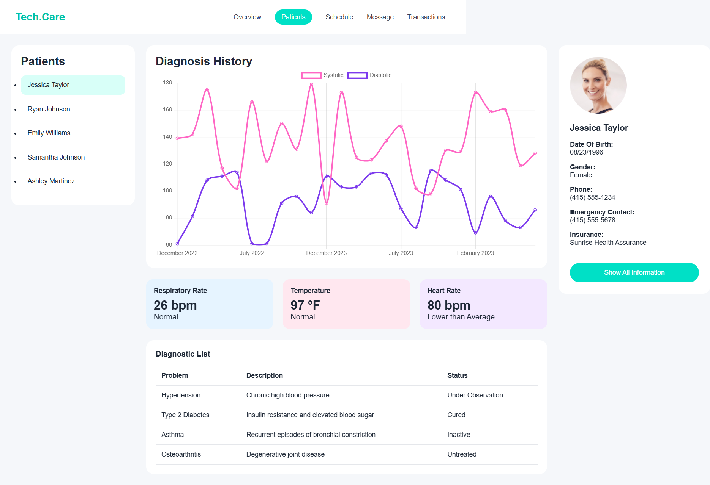

# Tech.Care — Healthcare Dashboard

A responsive patient dashboard built with **HTML5, CSS3, vanilla JavaScript and Chart.js**. The interface presents patient profile information, diagnosis history, vital signs and a diagnostic list in a clean dashboard layout.

## Dashboard preview



*Preview of the completed dashboard interface.*

## Features

- Patient profile details and contact information
- Blood pressure history visualised with Chart.js
- Respiratory rate, temperature and heart-rate cards
- Diagnostic list with problem, description and status
- Responsive layout for desktop, tablet and mobile screens
- API loading and error messaging

## Tech stack

- HTML5
- CSS3
- JavaScript (ES6+)
- Chart.js

## Run locally

1. Clone or download this repository.
2. Open the project folder in Visual Studio Code.
3. Install the **Live Server** extension.
4. Copy `config.example.js` and rename the copy to `config.js`.
5. Add the API URL and credentials that you are authorised to use in your local `config.js`.
6. Open `index.html` with Live Server.

The project uses Chart.js from a CDN, so an internet connection is required.

## API credentials and security

The real `config.js` file is intentionally excluded from version control. Never publish API usernames, passwords, access tokens or other secrets in a public repository. For production use, authenticated API requests should be handled by a secure backend rather than exposing credentials in browser-side JavaScript.

## Project structure

```
healthcare-dashboard/
├── index.html
├── style.css
├── script.js
├── package.json
├── tsconfig.json
├── config.example.js
├── .gitignore
└── dashboard_index.png
```

## Note

This repository is a portfolio/demo project. Use only authorised test data and API access.
